# Klosti



See every rule, skill, hook and MCP server your coding agents (Claude Code, Codex, Cursor, Gemini) use, where each one applies, and what overlaps or contradicts. Fix contradictions in place, with backups and undo.

## Layout

- `engine/`: the TypeScript engine and CLI (`npx klosti`). Scanner, analysis, AI review and fixes, local server. See [engine/README.md](engine/README.md).
- `app/`: the macOS desktop app (Tauri). A menu bar app that runs the engine in the background, shows Klosti in a window, and sends a notification when your agent setup changes.
- `src/template.html`: the interface, shared by the CLI and the app.
- `brand/`: the shared brand. `tokens.css` is the single source for colors and fonts in the app and the site, synced with `node brand/sync.mjs`. See [brand/BRAND.md](brand/BRAND.md).
- `site/`: the marketing site (Next.js, static export to `site/out`). `npm run dev` to work on it, `npm run build` to export. Set `NEXT_PUBLIC_MAC_DOWNLOAD_URL` to the .dmg once it is published; until then the install section shows the build-from-source steps.
- `scripts/`: the original Python prototype, kept for reference. `install-watcher.py` installs a launchd job that runs the engine's scan with notifications, for use without the desktop app.

## Desktop app

Requires Node 20+, Bun and Rust.

```sh
cd engine && npm install && cd ../app && npm install
npm run build      # compiles the engine into a sidecar, then builds Klosti.app
npm run dev        # run in development
```

The app keeps running in the menu bar when its window is closed. The menu bar icon has Open, Scan now, Open at login and Quit. Data lives in `~/Library/Application Support/klosti`, shared with the CLI. Setups from before the rename keep using `agent-rulebook` until you move that folder.

## The name

*Klosti* (κλωστή) is Greek for thread. Greek fairy tales open with *κόκκινη κλωστή δεμένη*, "a red thread, tied". The app follows the thread from each agent to every rule, skill and hook it loads, and the logo is that red thread with one loop tied in it. Source files are in `app/icon-src/`.

## Privacy

Everything stays on your machine except what the AI features send to Claude (through your Claude Code, or your Anthropic API key). MCP entries keep only the server name, transport and host. Hook commands are shown with anything that looks like a credential masked. Skill history comes from Claude Code's session logs; only skill names, dates, project folders and the paths of files written or edited are kept, never the conversation. The app's data folder contains your instruction text.

## License

MIT, see [LICENSE](LICENSE).
